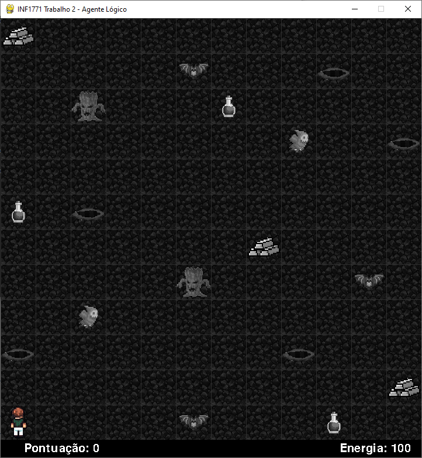
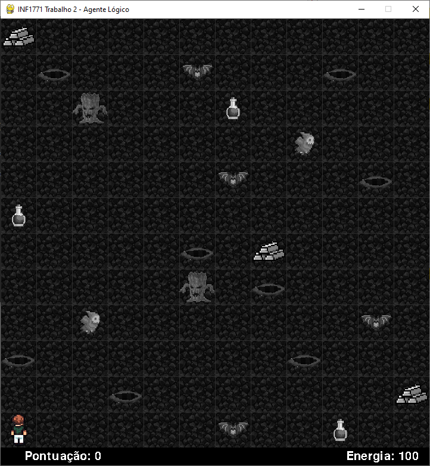
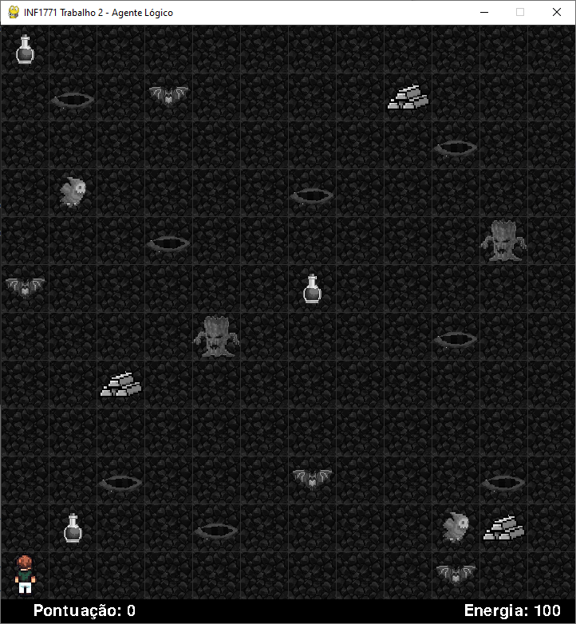

# GRUPO 1
Jayme Augusto Avelino de Paiva - 2210289
Arthur Hammond Aragão Poggy - 2310295
Rafael Gama Vergilio - 2320469

Link do vídeo:
https://youtu.be/AwENxsAP4dU

# Estratégia usada

Como o agente não sabe o quanto de ouro tem no mapa, fizemos ele percorre (ou tentar) todo o mapa de numa forma zigzag nas linhas, ou seja, percorrer a linha 1 toda da esquerda pra direita, a 2 da direita pra esquerda, a 3 da esquerda para a direita e por ae vai. Para isso usamos um A* a cada passo que vai focar em ir no proximo quadrado do mapa, esse A* considera no g custos 1000 para poço e teletransporte (ele supõe que no pior caso o teletransporte vai levar para um poço), e 80 para inimigos (supõe que inimigos vão dar dano máximo, 80) e 10 para quadrados já visitados (para fazer com que ele priorize caminhos passando por quadrados não visitados), a heuristica é a distancia de manhatam normal, e também colocamos algumas regras como se o agente não tiver nenhum ouro ainda e tiver preso numa região que todas os quadrados para sair dela possam ser poços, ele vai aceitar o risco de passar por um deles, escolhendo o que tem menor risco de ser um poço de fato, ele também vai aceitar passar por monstros se a vida dele for maior que 80, se em algum momento ele precisar passar por 1, mas a vida for menor que 80 ele vai fazer um A* até algum item de cura já encontrado, se ainda não tiver encontrado nenhum vai voltar para o inicio (essa é nossa condição de término, voltar pro inicio). Se ele ficar preso em uma região que corra risco de morrer, mas já tiver encontrado ouro ele decide que é o suficiente e volta para o inicio também. Ao voltar pro inicio ele aceita passar por monstros desde que possa sobreviver. A condição para voltar pro inicio é explorar tudo ou ficar preso numa região (ou fora dela dependendo do seu ponto de vista), mas já possuindo algo de ouro.

# INF1771_Wumpus_Prolog_Python

Warning - swipl module is currently compatible with swi-prolog 8.4.3 download here  https://www.swi-prolog.org/download/stable/bin/swipl-8.4.3-1.x64.exe.envelope

Mapa Fácil

Mapa Médio

Mapa Difícil

